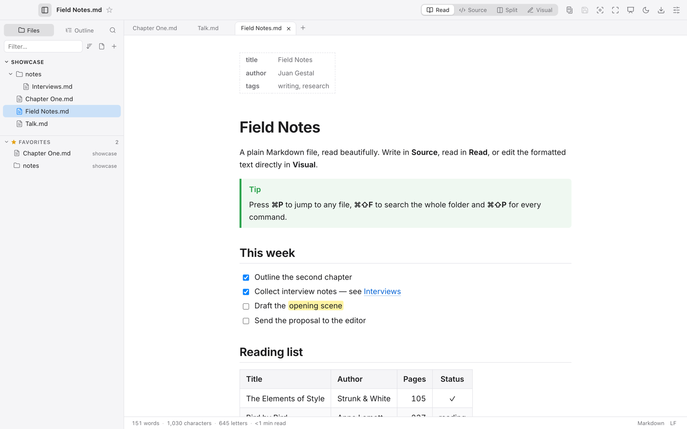
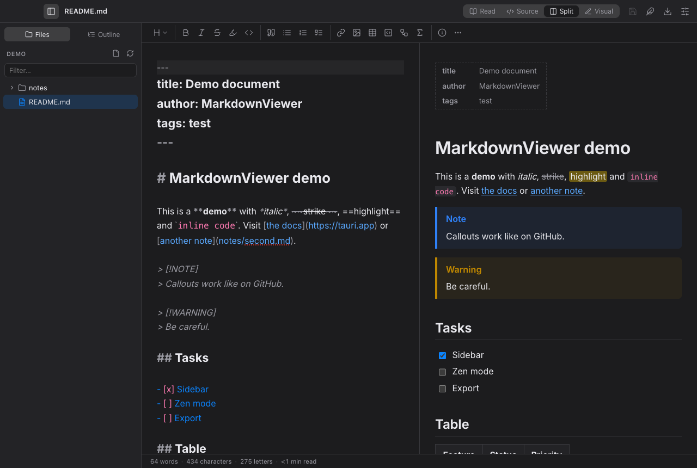
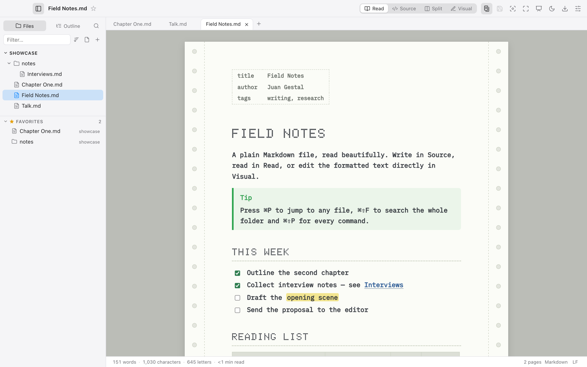
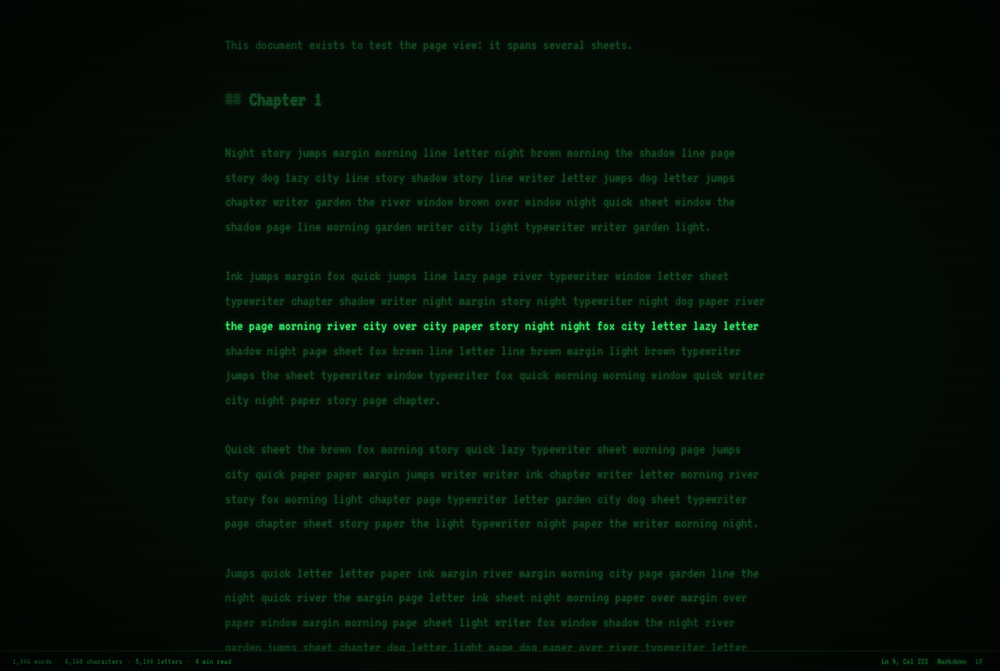
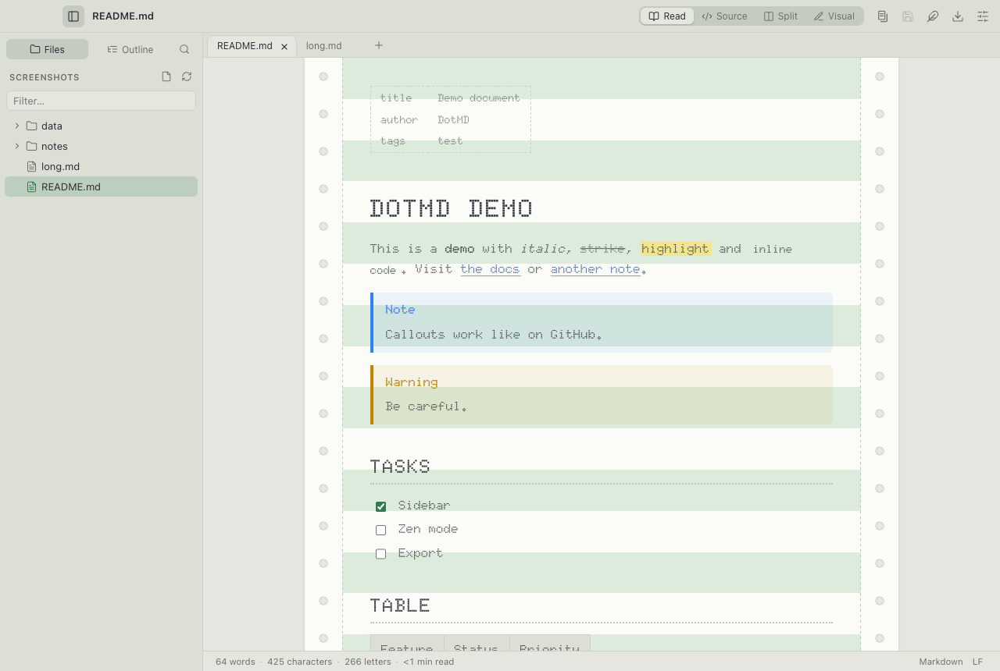
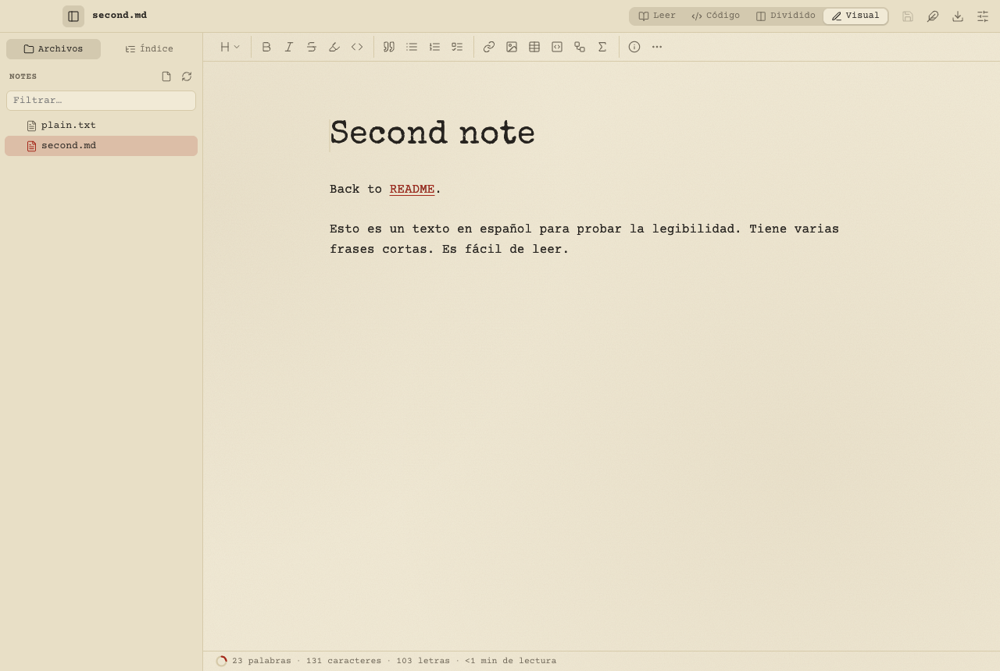
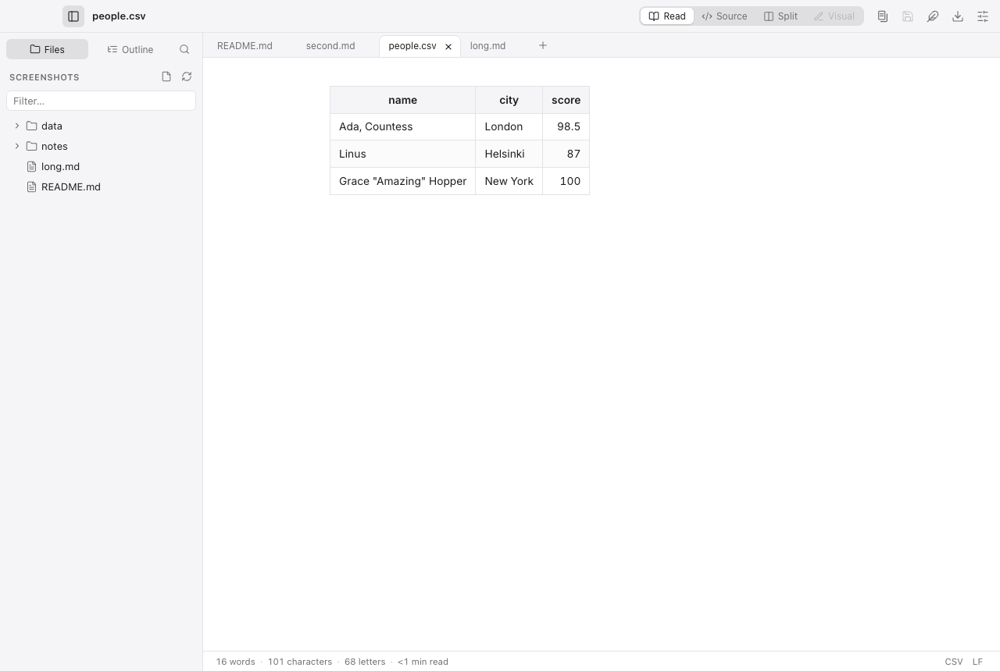
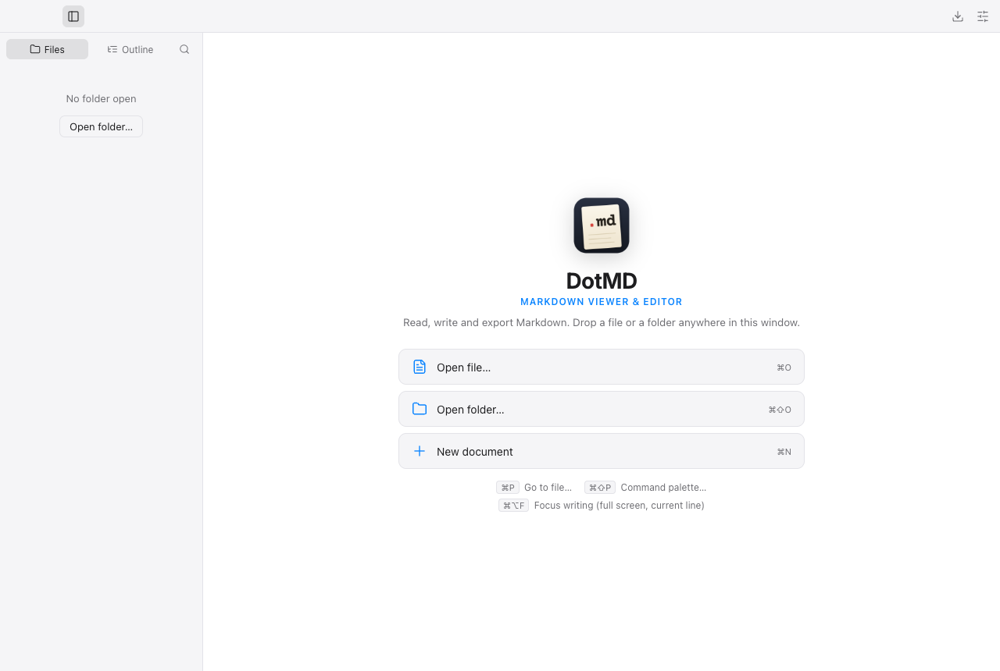
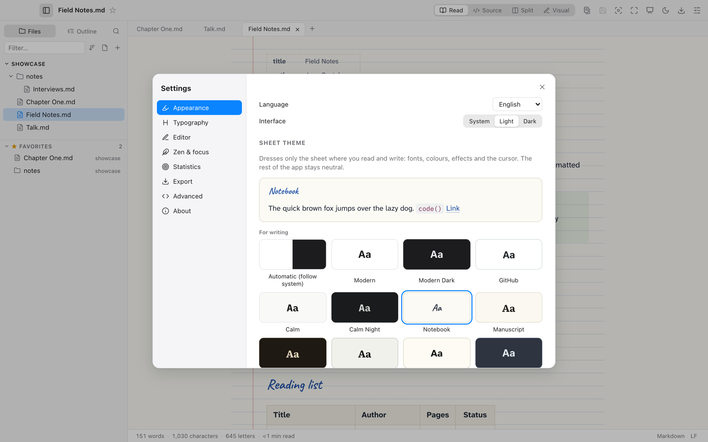

# DotMD — Markdown Viewer & Editor

**A fast, native-feeling Markdown and text viewer and editor for macOS, Windows and Linux.**
Read, write and export Markdown, from a quick look at a README to a long distraction-free writing session.

Built with [Tauri 2](https://tauri.app) (Rust) and [Svelte 5](https://svelte.dev). The app bundle is about 10 MB.



## Features

- **Four modes**: *Read*, *Source* (raw Markdown or plain text), *Split* (source and preview, with synced scrolling) and *Visual* (WYSIWYG, edit on the formatted document). Switch with ⌘1–4.
- **Page view** (⌘⌥P): the preview laid out on A4/Letter sheets with the export margins and page numbers, so you see the PDF before exporting. Manual page breaks.
- **Any text file**: Markdown, plain text, logs, CSV/TSV (shown as a table), JSON, YAML, source code (highlighted by language), README/LICENSE… UTF-8, UTF-16 and Latin-1, Windows line endings preserved.
- **Folder sidebar** you can hide (⌘\\), resize or move to the right, with a filter, an outline tab, folder-wide search (⌘⇧F) and a native context menu (new, rename, move by dragging, Move to Trash).
- **Tabs**, back/forward history (⌘[ / ⌘]), **quick open** (⌘P) and a **command palette** (⌘⇧P), plus a full native menu bar.
- **Drag & drop** files and folders. Open from the command line or the OS "Open with…". Paste or drop images into the editor and they are saved to `assets/`.
- **Formatting toolbar**:
  - Headings, emphasis, lists, tasks, links and images.
  - A grid picker for tables and one-click table alignment.
  - Code blocks by language, 10 Mermaid templates, math, GitHub callouts, footnotes and collapsible sections.
- **Rendering**: GitHub Flavored Markdown, Mermaid diagrams, KaTeX math, syntax highlighting, front matter, clickable task lists and links between notes.
- **Live reload** when another program changes the open file.
- **Statistics under the document**: words, characters, letters, sentences, paragraphs and reading time, each toggled separately, plus cursor position, document type and line endings.
  - The detail panel adds a readability score adapted to the document's language (Flesch, Fernández-Huerta, Kandel-Moles, Amstad, Flesch-Vacca, Martins) and a word goal with a progress ring.
- **Zen mode**:
  - Full screen, with focus highlighting on the current line, sentence or paragraph.
  - Typewriter scrolling, which keeps the cursor centered.
  - Optional typing sounds, including **real typewriter recordings** (CC0) panned by key position, with a margin bell and carriage return.
  - One-click **Typewriter mode**.
- **Focus writing** (⌘⌥F): full screen, only the line you are typing lit, caret kept centered.
- **18 themes**, including **Calm** and **Calm Night** (iA Writer fonts), **Typewriter** (paper texture, uneven ink), **Screenplay** (Hollywood format in Courier 12 pt), **Continuous paper** (green-bar tractor-feed paper with sprocket holes and a dot-matrix font), **CRT** green and amber (scanlines, glow, flicker, adjustable strength), **MS-DOS** (IBM VGA font), **Terminal** and **Mac OS X Aqua**. Themes dress only the **sheet** where you read and write (fonts, colours, effects and an animated cursor — a glowing block prompt in Terminal and CRT, a fading bar in Calm); the interface stays neutral, light or dark. Body text always uses a legible face, decorative ones (dot matrix, VT323, VGA) are kept for headings, and every theme passes a WCAG contrast test. Settings only offer the effects and sounds the active theme supports.
- **Distraction-free mode** (⌘⇧↩): only the sheet remains; moving the mouse brings back a small bar with the word count, typing hides it.
- **Screenplay mapping**: `#` title, `##` scene heading, `###` character, `>` dialogue, `*(…)*` parenthetical, `####` transition.
- Every bundled font covers Spanish completely (checked in CI by `scripts/check-fonts.py`).
  - Customize the accent color, fonts, size, line height, text width and paragraph spacing, or add your own CSS.
- **Export** to self-contained HTML (fonts embedded) and to PDF, one file or **in batch**, with an option to merge everything into a single document and a table of contents. PDFs are printed natively on macOS and Linux.
- **Command line**: `dotmd --export pdf notes.md notes.pdf` exports without opening a window.
- **Presentations**: any Markdown document is a deck — `---` separates slides, a paragraph starting with `Note:` holds the speaker notes. Present full screen (⌘⌥↩; arrows, N for notes, Esc), or export the slides as a 16:9 PDF or an HTML deck (`dotmd --export pdf talk.md --slides`).
- **Languages**: English (default), Spanish, French, German, Italian, Portuguese, Catalan and Galician.
- **Preferences** can be exported, imported or kept in a synced folder (Google Drive, Dropbox, iCloud…).

| Split mode | Page view | Focus writing (CRT theme) |
|---|---|---|
|  |  |  |
| **Continuous paper theme** | **Typewriter theme (visual editor)** | **CSV as a table** |
|  |  |  |
| **Welcome** | **Settings** | |
|  |  | |

## Development

Requirements: [Rust](https://rustup.rs), Node.js 20+ and the [Tauri prerequisites](https://tauri.app/start/prerequisites/) for your OS.

```bash
npm install
npm run tauri dev     # run in development
npm run tauri build   # build installers
npm run check         # type-check the frontend
cd src-tauri && cargo test
```

PDF export uses the system WebKit on macOS and Linux. Elsewhere, or if that fails, it uses Chrome, Edge, Brave or Chromium if one is installed, and otherwise opens the print dialog.

UI tests (`npm run test:ui`) drive the frontend in headless Chrome with a fake Tauri bridge backed by the real Rust renderer; set `CHROME_PATH` if Chrome is not in a standard location.

## Roadmap

See [PLAN.md](PLAN.md) and the [issues](https://github.com/jgestal/dotmd/issues), grouped by milestone.

## Credits

Created by **Juan Gestal** — [juan@gestal.es](mailto:juan@gestal.es) · [gestal.es](https://gestal.es)

Fonts: Inter, Literata, IBM Plex, Courier Prime, Special Elite, VT323, Doto, iA Writer Quattro & Mono, JetBrains Mono, Atkinson Hyperlegible Next, Lexend and Source Serif 4 (SIL Open Font License); IBM VGA 8×16 from [The Ultimate Oldschool PC Font Pack](https://int10h.org/oldschool-pc-fonts/) by VileR (CC BY-SA 4.0). Licences are next to the files in `static/fonts/`.

## License

[MIT](LICENSE) © Juan Gestal. Third-party sound credits are in [static/sounds/CREDITS.md](static/sounds/CREDITS.md).
