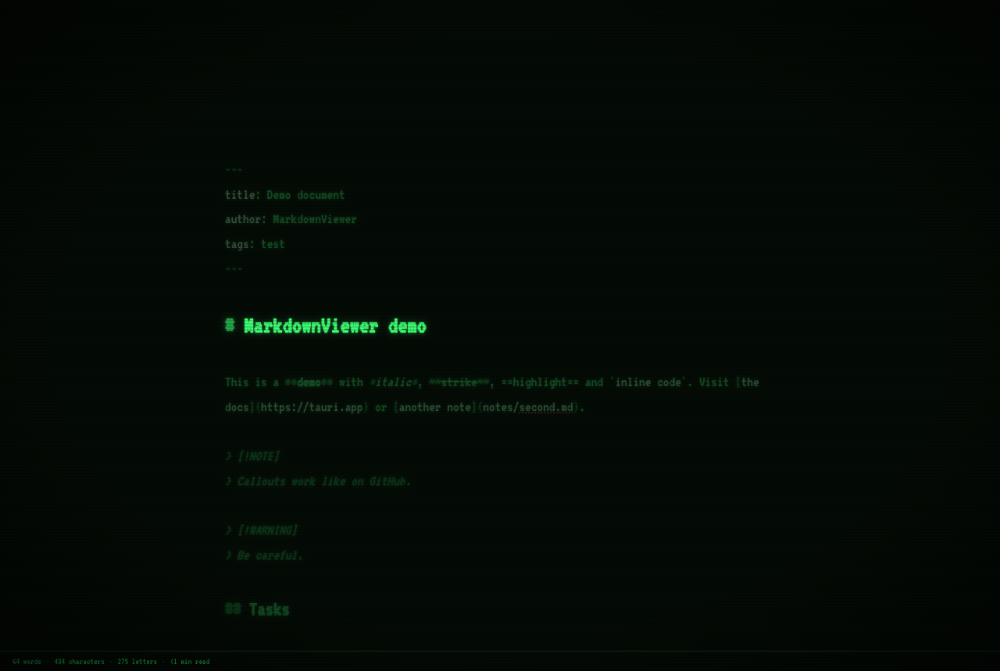

# DotMD

**A fast, native-feeling Markdown viewer and editor for macOS, Windows and Linux.**
Read, write and export Markdown, from a quick look at a README to a long distraction-free writing session.

Built with [Tauri 2](https://tauri.app) (Rust) and [Svelte 5](https://svelte.dev). The app bundle is about 10 MB.


## Features

- **Four modes**: *Read*, *Source* (raw Markdown or plain text), *Split* (source and preview, with synced scrolling) and *Visual* (WYSIWYG, edit on the formatted document). Switch with ⌘1–4.
- **Folder sidebar** you can hide (⌘\\), resize or move to the right, with a filter, an outline tab and a native context menu.
- **Drag & drop** files and folders. Open from the command line or the OS "Open with…".
- **Formatting toolbar**:
  - Headings, emphasis, lists, tasks, links and images.
  - A grid picker for tables and one-click table alignment.
  - Code blocks by language, 10 Mermaid templates, math, GitHub callouts, footnotes and collapsible sections.
- **Rendering**: GitHub Flavored Markdown, Mermaid diagrams, KaTeX math, syntax highlighting, front matter, clickable task lists and links between notes.
- **Live reload** when another program changes the open file.
- **Statistics under the document**: words, characters, letters, sentences, paragraphs and reading time, each toggled separately.
  - The detail panel adds a readability score (Flesch for English, Fernández-Huerta for Spanish) and a word goal with a progress ring.
- **Zen mode**:
  - Full screen, with focus highlighting on the current line, sentence or paragraph.
  - Typewriter scrolling, which keeps the cursor centered.
  - Optional typing sounds.
- **11 themes**, including **Typewriter** (paper texture, uneven ink) and **CRT** green and amber (scanlines, glow, flicker).
  - Customize the accent color, fonts, size, line height, text width and paragraph spacing, or add your own CSS.
- **Export** to self-contained HTML and to PDF, one file or **in batch**, with an option to merge everything into a single document and a table of contents.
- **Languages**: English (default) and Spanish.

| Split mode | Typewriter theme | CRT + Zen |
|---|---|---|
|  |  |  |

## Development

Requirements: [Rust](https://rustup.rs), Node.js 20+ and the [Tauri prerequisites](https://tauri.app/start/prerequisites/) for your OS.

```bash
npm install
npm run tauri dev     # run in development
npm run tauri build   # build installers
npm run check         # type-check the frontend
cd src-tauri && cargo test
```

PDF export prefers the system webview. When that is unavailable, it uses Chrome, Edge, Brave or Chromium if one is installed, and otherwise opens the print dialog.

## Roadmap

See [PLAN.md](PLAN.md) and the [issues](https://github.com/jgestal/dotmd/issues), grouped by milestone.

## License

[MIT](LICENSE) © Juan Gestal. Third-party sound credits are in [static/sounds/CREDITS.md](static/sounds/CREDITS.md).
