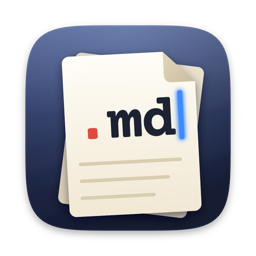
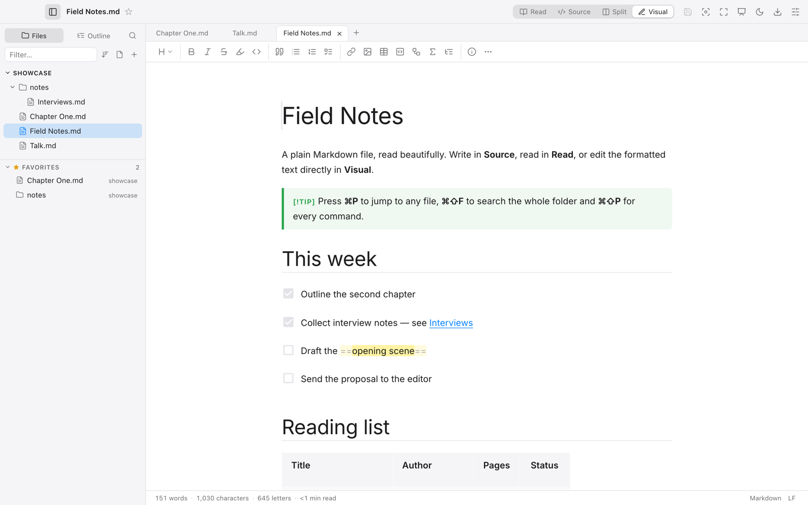
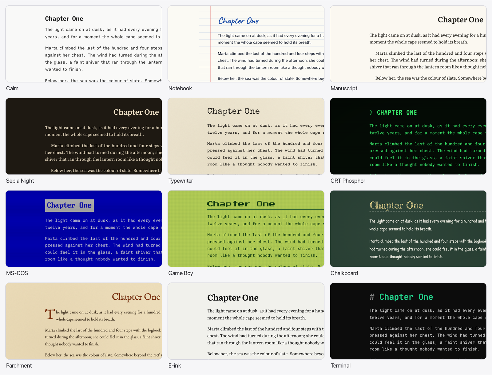
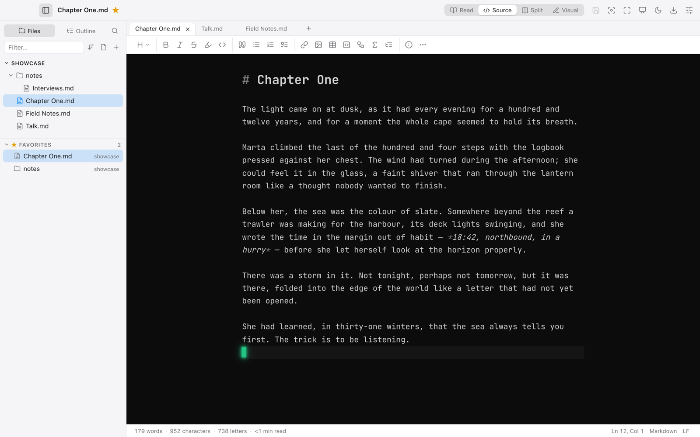
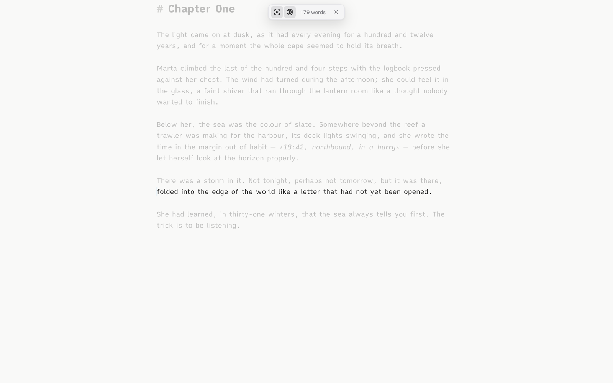
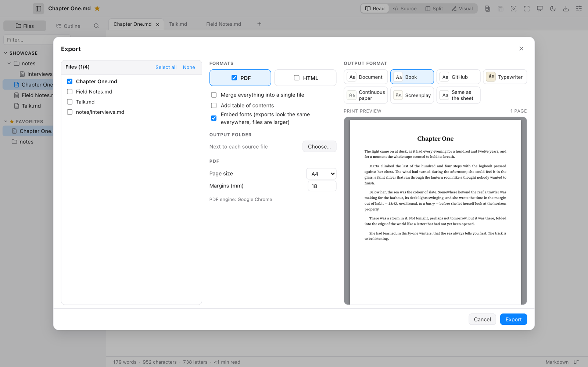
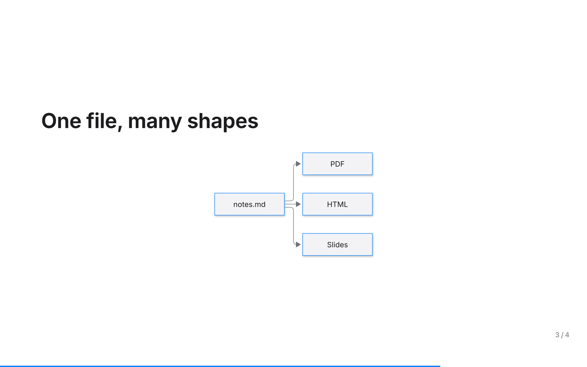
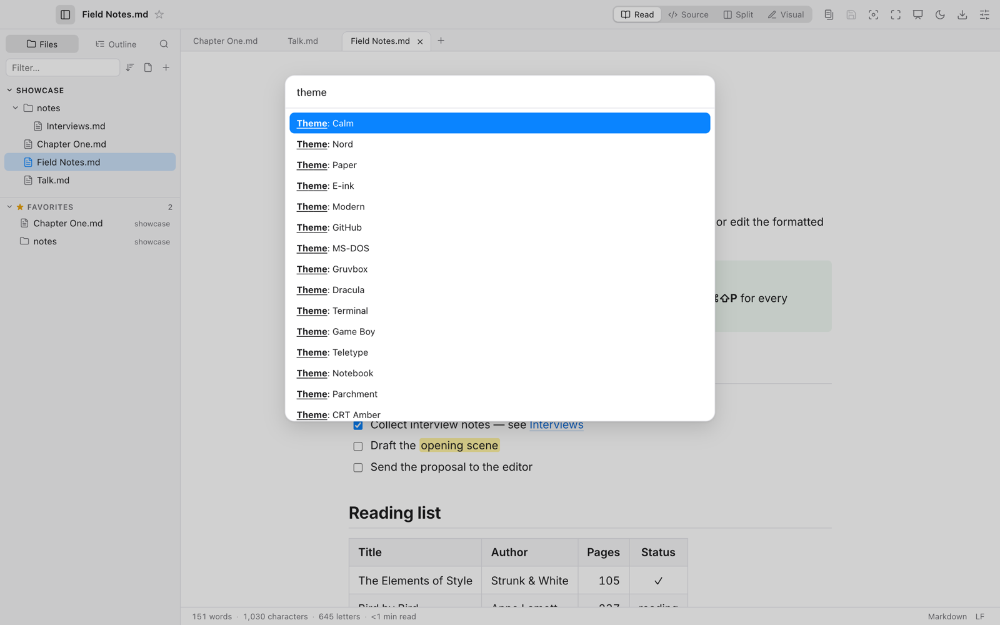

<div align="center">



# DotMD

**A fast, native-feeling Markdown & text editor for macOS, Windows and Linux.**

Read, write, present and export Markdown — from a quick look at a README to a long, distraction-free writing session.

[](https://github.com/jgestal/dotmd/actions/workflows/ci.yml)
[](https://github.com/jgestal/dotmd/releases/latest)
[](LICENSE)


[**Download**](https://github.com/jgestal/dotmd/releases/latest) · [Features](#features) · [Shortcuts](#keyboard-shortcuts) · [Command line](#command-line) · [Build](#building-from-source)


</div>

## Why DotMD

- **Plain files, nothing else.** DotMD opens the folders you already have. No library, no import, no lock-in — your notes stay `.md` files you can sync, diff and back up.
- **Native and fast.** Built on [Tauri 2](https://tauri.app) and Rust: a ~15 MB app that starts instantly, follows your system's light/dark mode, menus and shortcuts, and renders large documents smoothly.
- **Made for writing.** Sheet themes with legible type, an animated cursor that suits each theme, focus modes, typewriter sounds and word goals.
- **Ready to share.** Export to PDF or HTML with a live print preview, in the format you choose — independent of how you write — or present the document as slides.

## Features

### Read, write and edit three ways

| Read | Split | Visual |
|---|---|---|
|  |  |  |

- **Read** the rendered document, **Source** for raw Markdown, **Split** with synced scrolling, or **Visual** to edit the formatted text directly (WYSIWYG). Switch with ⌘1–⌘4.
- GitHub Flavored Markdown with **Mermaid** diagrams, **KaTeX** maths, syntax highlighting, callouts, `==highlight==`, footnotes, front matter, clickable task lists and links between notes (hover one to preview it, ⌘-click it in the editor to follow it).
- **Any text file**: plain text, logs, CSV/TSV as a table, JSON, YAML and source code; UTF-8, UTF-16 and Latin-1; Windows line endings preserved.
- A formatting toolbar, table grid picker and aligner, smart paste (web pages become Markdown, a URL over a selection becomes a link) and images pasted or dropped straight into `assets/`.

### Sheet themes for every kind of writing



**32 sheet themes**, from quiet to playful: Calm and Calm Night (iA Writer type), Notebook, Manuscript, Sepia Night, E-ink, Accessible (Atkinson Hyperlegible), Gruvbox, Catppuccin, Nord, Solarized… and Typewriter, Screenplay, Continuous paper, CRT phosphor, MS-DOS, Terminal, Game Boy, Chalkboard, Teletype, Parchment and Mac OS X Aqua.

- Themes dress only the **sheet** where you read and write; the interface stays neutral, light or dark.
- Body text always uses a legible face — decorative fonts (dot matrix, VT323, VGA, chalk) are for headings — and **every theme passes a WCAG contrast test** in CI.
- Each theme has its own **cursor**: a glowing block prompt in Terminal and CRT, a fading blue bar in Calm, a striking block in Typewriter. Some bring **sounds** too: real typewriter recordings with a margin bell, chalk, a quill.

| Terminal: a glowing prompt | Distraction-free writing |
|---|---|
|  |  |

### Write without distractions

- **Distraction-free mode** (⌘⇧↩): only the sheet remains. Move the mouse for a small bar with focus, typewriter scrolling and your word goal; start typing and it disappears.
- **Focus** on the current line, sentence or paragraph, and **typewriter scrolling** that keeps the cursor centred.
- **Statistics**: words, characters, reading time, readability adapted to the document's language, a word goal and the time you actually spent writing this session.

### Export what you see



- **PDF and HTML**, one file or a whole folder at once, optionally merged into a single document with a table of contents.
- **Output formats** — Document, Book, GitHub, Typewriter, Continuous paper, Screenplay or your sheet theme — chosen when exporting, with a **live preview of the real pages**.
- **Page view** (⌘⌥P) lays the document out on sheets exactly as it will print, with long tables split across pages and their headers repeated.
- Native PDF printing on macOS and Linux (no browser needed), fonts embedded in exports.

| Page view on continuous paper | Presentations |
|---|---|
|  |  |

### Present

Any document is a deck: `---` starts a new slide and a paragraph beginning with `Note:` holds the speaker notes. Present full screen (⌘⌥↩), or export the slides to a 16:9 PDF or an HTML deck.

### Work with folders, not files

- A **sidebar** with several folders at once, **favourites** (files and folders), filter, sort by name or date, outline and **folder-wide search** (⌘⇧F).
- **Tabs** that remember their scroll position, back/forward history, **quick open** (⌘P), a **command palette** (⌘⇧P) and a searchable **keyboard shortcuts** sheet (⌘⌥/).
- Move, rename, duplicate and trash files from the tree; drag files out of the window into Finder, Explorer or an e-mail; live reload when another app changes a file.

### Feels at home on your system

- Native menus laid out per platform (macOS app menu, Services, Window list, Show in Finder / Explorer, Revert to Saved…), native dialogs and context menus.
- The window remembers its size and position; on macOS the close button shows unsaved changes.
- **8 languages**: English, Spanish, French, German, Italian, Portuguese, Catalan and Galician.
- **Preferences** can be exported, imported or kept in a synced folder (Google Drive, Dropbox, iCloud) to share them across computers.
- Automatic, signed updates.

| Settings: live sheet preview | Command palette |
|---|---|
|  |  |

## Installation

Download the latest version from **[Releases](https://github.com/jgestal/dotmd/releases/latest)**:

| System | File |
|---|---|
| macOS (Apple Silicon and Intel) | `DotMD_x.y.z_universal.dmg` |
| Windows 10/11 | `DotMD_x.y.z_x64-setup.exe` or `.msi` |
| Linux | `.AppImage`, `.deb` or `.rpm` |

> [!NOTE]
> DotMD is not notarised by Apple yet. On first launch macOS may say it cannot verify the developer: open **System Settings → Privacy & Security** and click **Open Anyway**, or run `xattr -dr com.apple.quarantine /Applications/DotMD.app`. On Windows, if SmartScreen appears, choose **More info → Run anyway**.

## Keyboard shortcuts

| Action | macOS | Windows / Linux |
|---|---|---|
| Read · Source · Split · Visual | ⌘1 · ⌘2 · ⌘3 · ⌘4 | Ctrl+1…4 |
| Go to file · Command palette | ⌘P · ⌘⇧P | Ctrl+P · Ctrl+Shift+P |
| Search in folder | ⌘⇧F | Ctrl+Shift+F |
| Find · Find next · Replace | ⌘F · ⌘G · ⌘⌥R | Ctrl+F · Ctrl+G · Ctrl+Alt+R |
| Distraction-free mode | ⌘⇧↩ | Ctrl+Shift+Enter |
| Page view · Present | ⌘⌥P · ⌘⌥↩ | Ctrl+Alt+P · Ctrl+Alt+Enter |
| Reopen closed tab | ⌘⇧T | Ctrl+Shift+T |
| Insert / update table of contents | ⌘⌥T | Ctrl+Alt+T |
| All shortcuts | ⌘⌥/ | Ctrl+Alt+/ |

## Command line

Help → *Install "dotmd" command* puts `dotmd` on your PATH.

```bash
dotmd notes.md                               # open in DotMD (reuses the open window)
dotmd --export pdf notes.md                  # notes.pdf next to notes.md, no window
dotmd --export html docs/ -o site/           # a whole folder, keeping sub-folders
dotmd --export pdf a.md b.md --merge -o book.pdf
dotmd --export pdf novel.md --style book     # document, book, github, typewriter, tractor, screenplay, sheet
dotmd --export pdf talk.md --slides          # one 16:9 page per slide
```

## Building from source

Requirements: [Rust](https://rustup.rs), Node.js 20+ and the [Tauri prerequisites](https://tauri.app/start/prerequisites/) for your system.

```bash
npm install
npm run tauri dev        # run in development
npm run tauri build      # build installers
```

### Tests

| Suite | Command | What it covers |
|---|---|---|
| Type check | `npm run check` | Svelte and TypeScript |
| Unit and use cases | `npm test` · `npm run test:coverage` | Domain rules, use cases with in-memory adapters, architecture rules, themes (WCAG contrast), locales |
| Rust | `cd src-tauri && cargo test` | Decoding, CLI parsing, search, file system |
| UI | `npm run test:ui` | Every screen and flow in headless Chrome with a fake Tauri bridge (set `CHROME_PATH` if needed) |
| End to end | `npm run test:cli` | The real executable: window, single instance, PDF/HTML exports, slides, formats |
| Fonts | `python3 scripts/check-fonts.py` | Every bundled font covers Spanish completely |

CI runs all of them, the end-to-end suite on macOS, Windows and Linux, and builds the installers. The code follows a clean architecture (domain, ports, use cases, adapters) described in [ARCHITECTURE.md](ARCHITECTURE.md).

## Roadmap

Ideas for the next versions — wiki links and backlinks, tags, a note graph, a Pomodoro timer, style checks, DOCX/EPUB export and more — are tracked as [issues](https://github.com/jgestal/dotmd/issues). Suggestions are welcome.

## Credits

Created by **Juan Gestal** — [juan@gestal.es](mailto:juan@gestal.es) · [gestal.es](https://gestal.es)

Built with Tauri, Svelte, CodeMirror, Milkdown, comrak, Mermaid and KaTeX.

Fonts: Inter, Literata, IBM Plex, Courier Prime, Special Elite, VT323, Doto, iA Writer Quattro & Mono, JetBrains Mono, Atkinson Hyperlegible Next, Lexend, Source Serif 4, EB Garamond, IM Fell English, Caveat, Patrick Hand, Fredericka the Great, Press Start 2P and Pixelify Sans (SIL Open Font License); IBM VGA 8×16 from [The Ultimate Oldschool PC Font Pack](https://int10h.org/oldschool-pc-fonts/) by VileR (CC BY-SA 4.0). Licences are next to the files in `static/fonts/`. Typewriter sounds are CC0 recordings from Freesound — see [static/sounds/CREDITS.md](static/sounds/CREDITS.md).

## License

[MIT](LICENSE) © 2026 Juan Gestal
