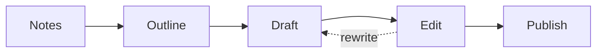

# Field Notes

A plain Markdown file, read beautifully. Write in **Source**, read in **Read**, or edit the formatted text directly in **Visual**.

> [!TIP]
> Press **⌘P** to jump to any file, **⌘⇧F** to search the whole folder and **⌘⇧P** for every command.

## This week

- [x] Outline the second chapter
- [x] Collect interview notes — see [Interviews](notes/Interviews.md)
- [ ] Draft the ==opening scene==
- [ ] Send the proposal to the editor

## Reading list

| Title                     | Author           | Pages | Status   |
|:--------------------------|:-----------------|------:|:--------:|
| The Elements of Style     | Strunk & White   |   105 | ✓        |
| Bird by Bird              | Anne Lamott      |   237 | reading  |
| On Writing                | Stephen King     |   288 |          |

## How a chapter gets written



## A little maths

The reading time of a page of $w$ words at $r$ words per minute is $t = \frac{w}{r}$.

$$
\text{Flesch} = 206.835 - 1.015\,\frac{\text{words}}{\text{sentences}} - 84.6\,\frac{\text{syllables}}{\text{words}}
$$

## Code

```python
def word_goal(words: int, goal: int = 1000) -> str:
    return f"{words}/{goal} words ({min(100, words * 100 // goal)} %)"
```

> [!NOTE]
> Every export keeps diagrams, maths and highlighted code — and you can choose the look of the PDF independently of how you write.
