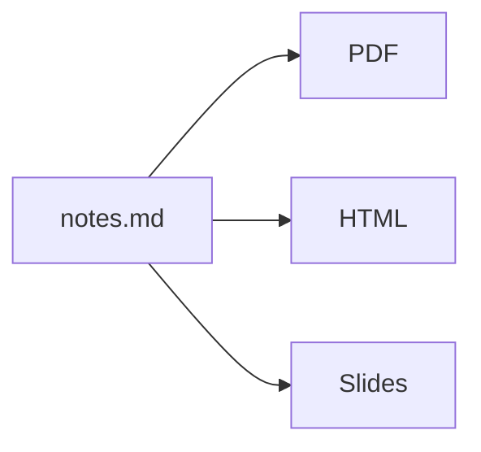

# Writing in plain text

A short talk · DotMD

---

## Why Markdown?

- It is just text: it opens anywhere, forever
- It diffs, syncs and backs up like code
- It exports to anything

Note: Ask the audience how many of them have lost a document to a file format.

---

## One file, many shapes

---

# Thank you

github.com/jgestal/dotmd
