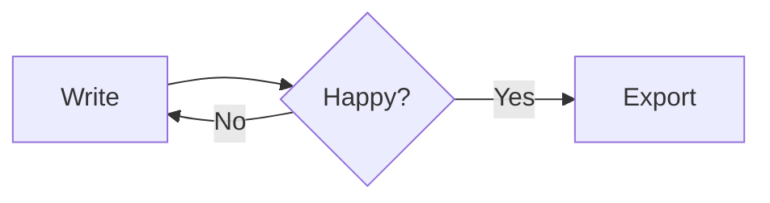

# DotMD demo

This is a **demo** with *italic*, ~~strike~~, ==highlight== and `inline code`. Visit [the docs](https://tauri.app) or [another note](notes/second.md).

> [!NOTE]
> Callouts work like on GitHub.

> [!WARNING]
> Be careful.

## Tasks

- [x] Sidebar
- [ ] Zen mode
- [ ] Export

## Table

| Feature | Status | Priority |
| ------- | :----: | -------: |
| Preview | done   | 1        |
| Export  | wip    | 2        |

## Code

```rust
fn main() {
    println!("Hello, world!");
}
```

## Mermaid



## Math

Inline $E = mc^2$ and display:

$$
\int_0^\infty e^{-x^2} dx = \frac{\sqrt{\pi}}{2}
$$

Footnote here[^1].

[^1]: The footnote.
